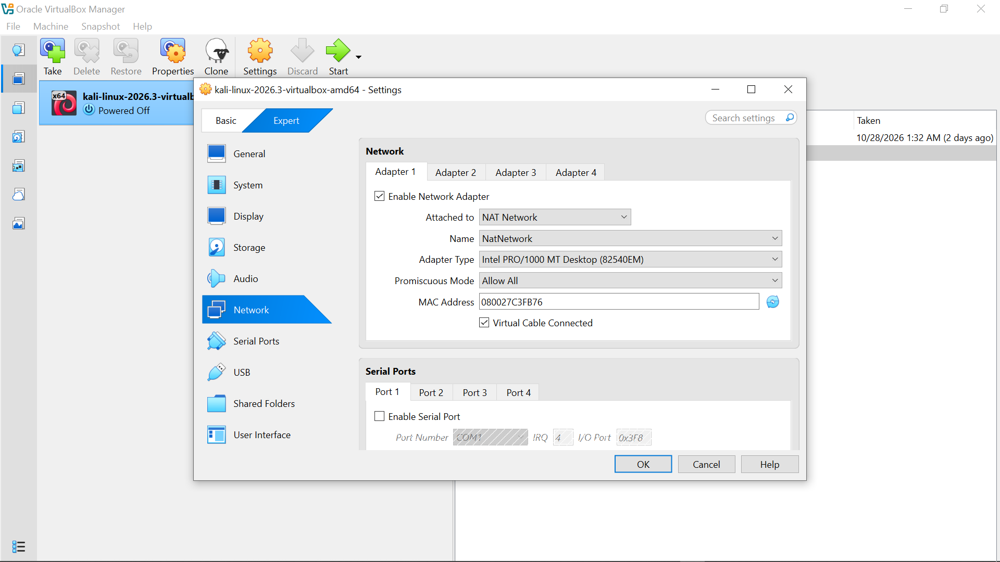
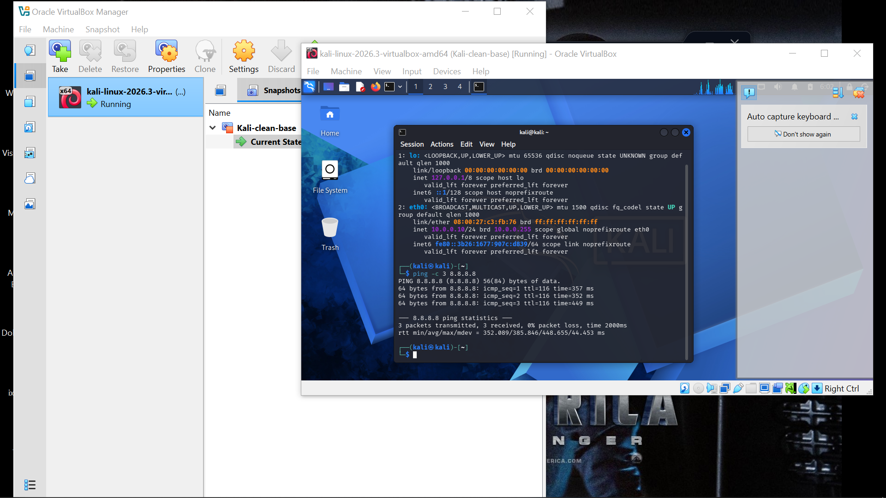
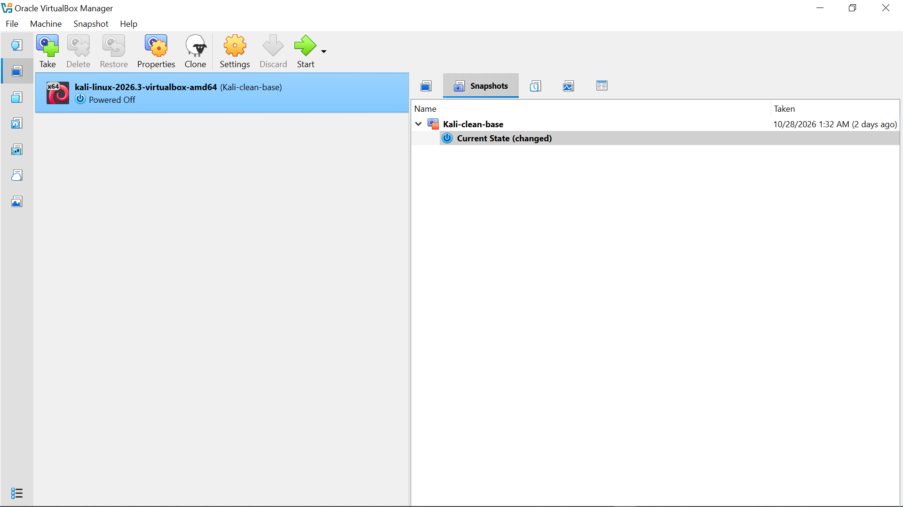
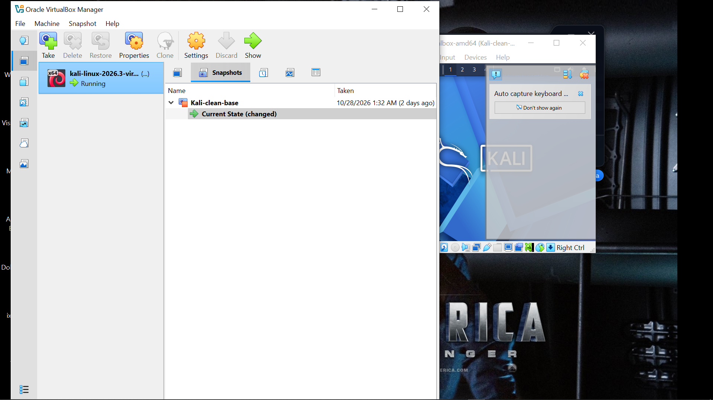

# Cybersecurity Lab Environment Setup

Building an isolated virtual lab for ethical hacking and network analysis practice.

## Project Overview

This project sets up a virtual cybersecurity lab using VirtualBox and Kali Linux on my own laptop. The lab runs on a private virtual network, so more machines can be added later and used as targets for authorized practice.

## Tools Used

- VirtualBox
- Kali Linux (pre-built VM)
- 7-Zip
- Wireshark
## Lab Setup Steps

### 1. Install the tools
Installed 7-Zip and VirtualBox on my laptop, then downloaded the pre-built Kali Linux VirtualBox image from the official Kali website and extracted it with 7-Zip.

### 2. Create the lab network
Created a NAT Network in VirtualBox using the range 10.0.0.0/24, so all lab machines share one private network.

### 3. Import Kali and attach it to the network
Imported the Kali VM into VirtualBox and set Adapter 1 to NAT Network, using the network created in the previous step.

### 4. Configure a static IP
Set a static IP of 10.0.0.10/24 on Kali, with gateway 10.0.0.1 and DNS 8.8.8.8, then checked the address and internet access.

### 5. Take a clean snapshot
Shut the VM down and saved a snapshot called kali-clean-base, so I can restore a working lab if something breaks.

### 6. Kali Virtual Machine Running

Opened the Kali virtual Machine to show its in a running state.

